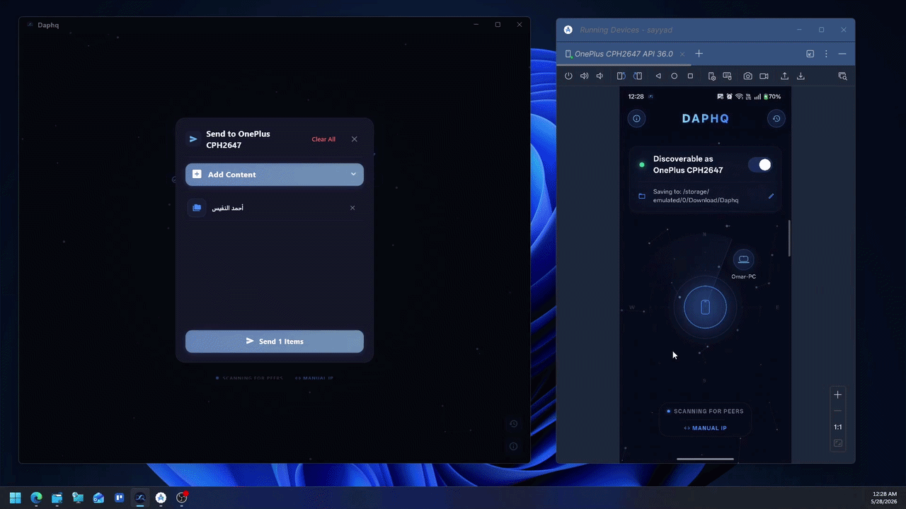
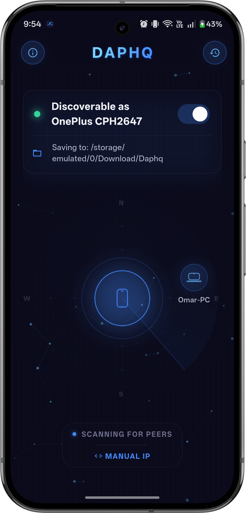
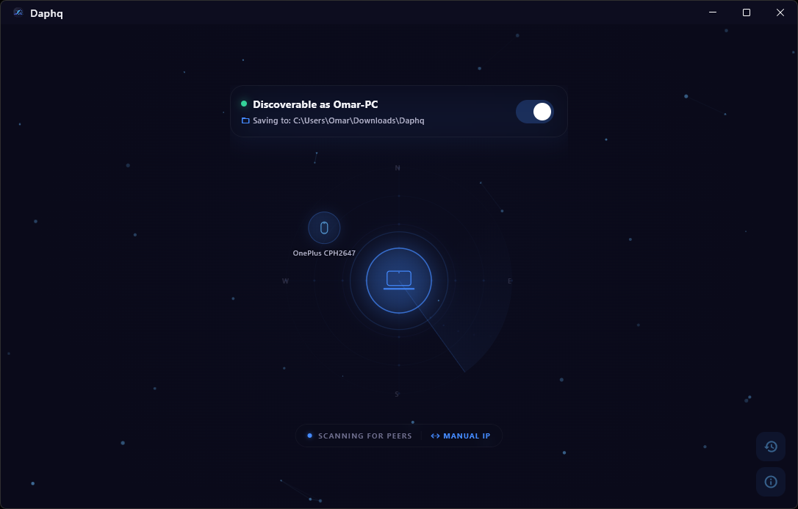

<div align="center">
  <a href="https://omarafifi-cse.github.io/daphq/">
    
  </a>

  <h1>Daphq</h1>
  <p><b>No cables. No cloud. Just full-speed transfers.</b></p>
  <p><i>Move gigabytes of photos, 4K videos, and entire folders directly between Windows and Android at full 5GHz Wi-Fi speed.</i></p>

  <p>
    <a href="https://omarafifi-cse.github.io/daphq/"></a>
    <a href="https://github.com/OmarAfifi-CSE/daphq/releases/latest"></a>
    <a href="https://github.com/OmarAfifi-CSE/daphq/blob/master/LICENSE"></a>
  </p>

  <p>
    
    
    
    
    
  </p>

  <br>
  
</div>

---

## 🧭 Why Daphq?

Moving big videos or whole photo albums between your phone and PC shouldn't require hunting for a USB cable, uploading to cloud storage, waiting on slow 2.4GHz links, or breaking your laptop's hotspot setup.

**Daphq** connects your Windows PC and Android phone straight across the room—automatically choosing the fastest local path so multi-gigabyte transfers finish in seconds.

| Story | The Experience | What Daphq Does |
| :--- | :--- | :--- |
| **📦 Move the Big Stuff** | Less *"still uploading..."* More *"already there."* Send 4K videos or entire folder trees without cloud limits or file compression. | Sends full folders intact at **80–90+ MB/s** on 5GHz Wi-Fi |
| **⚡ Zero-Touch 5GHz Link** | No typing IP addresses or fighting network settings. Open Daphq, pick a device, and transfer directly. | Automatic Bluetooth &amp; Wi-Fi pairing with bidirectional 5GHz host selection |
| **📡 Safe With Manual Hotspots** | Already running Windows Mobile Hotspot for other devices? Daphq never resets your password or shuts your hotspot down. | Detects &amp; reuses your active Windows Mobile Hotspot cleanly |
| **🖱️ Share From Anywhere** | Send straight from where your files already live instead of digging through pickers twice. | Right-click **Send via Daphq** in Windows Explorer or use Android's **Share** menu |
| **🔒 Nothing Leaves the Room** | Family photos and personal work never touch the internet, never burn mobile data, and never transfer without permission. | Local device-to-device transfers with explicit receiver approval |

---

## 📸 See It On Both Screens

Clean, calm, and consistent across desktop and mobile—featuring a live Orbital Radar with clear progress synced accurately on both ends.

<div align="center">
  <table>
    <tr>
      <th width="36%">Android App</th>
      <th width="64%">Windows Desktop</th>
    </tr>
    <tr>
      <td align="center" valign="middle">
        
      </td>
      <td align="center" valign="middle">
        
      </td>
    </tr>
    <tr>
      <td align="center">
        <i>Background Foreground Service keeps big transfers alive even when your screen turns off, with smooth system sharing.</i>
      </td>
      <td align="center">
        <i>Native Windows desktop layout with Orbital Radar, Explorer context menu integration, history log, and instant "Show in Folder".</i>
      </td>
    </tr>
  </table>
</div>

---

## ⚡ Open. Tap. Done.

```text
[01. Open Daphq]            ➔       [02. Tap a Device]          ➔       [03. Watch It Fly]
Turn on Receive on the               Nearby phones & PCs appear          Accept once on the receiving
device getting the files.            on your Orbital Radar.              device—5GHz Direct handles the rest.
```

> **Note on your very first Android direct transfer:** Android asks once to confirm connecting directly to your PC's Wi-Fi link. Because Daphq remembers and reuses consistent link credentials, future transfers reconnect smoothly without manual re-selection.

---

## ✨ Designed for Everyday Reliability

* **Real 5GHz Speed, Zero Bloat:** Streams directly over your local Wi-Fi hardware to saturate 802.11ac / Wi-Fi 6 speeds instead of throttling through slow web wrappers.
* **Bidirectional Smart Fallback:** If one device's Wi-Fi chip can't host a 5GHz direct group, Daphq flips hosting to the capable device automatically—keeping speeds high.
* **Whole Folder Reconstruction:** Drops nested folders onto your receiving device with the exact directory layout preserved. Duplicate filenames are renamed safely (`photo (1).jpg`) instead of overwriting existing files.
* **Transfer History & Quick Access:** Review completed transfers anytime and jump straight to received files with **Show in Folder**.
* **Clear Status, Not Cryptic Errors:** Friendly, human-readable status prompts and synced sender/receiver progress bars (`MB/s` and live ETA).

---

## 📥 Download Daphq

Get the latest ready-to-run builds for **Windows 10/11** and **Android** from the website or GitHub Releases:

<div align="center">
  <a href="https://omarafifi-cse.github.io/daphq/#download">
    
  </a>
  <a href="https://github.com/OmarAfifi-CSE/daphq/releases/latest">
    
  </a>
</div>

---

<details>
  <summary><b>🛠️ For Developers: Architecture, Local Setup &amp; Tests</b></summary>

### Split-Plane Architecture

* **Discovery & Trust Plane:** UDP broadcasts + BLE GATT beacons feed `PeerRegistry`. Device pairing and control actions (`startHostAndWait`, `joinHost`, transfer approval) run over **EC P-256 TLS** with SHA-256 certificate pinning (`lib/security/device_identity_service.dart`, `lib/security/trusted_devices_service.dart`).
* **Bulk Data Plane:** Multi-stream raw TCP workers (`lib/controllers/sender_controller.dart`, `lib/controllers/receiver_controller.dart`, `lib/controllers/v2_protocol_framing.dart`) using `tcpNoDelay`, zero-copy `Uint8List.sublistView` slicing, an `8 MB` socket flush threshold, and strict `safeRelativePath` traversal sanitization.
* **Native Radio Fabric:** Windows WinRT SoftAP & Wi-Fi Direct (`windows/direct/daphq_direct_win.cpp`) with deterministic PSK derivation (`DeriveStableDirectPsk`) and manual hotspot preservation; Android Kotlin BLE/P2P controller (`android/app/src/main/kotlin/com/omarafifi/daphq/DirectFabricHandler.kt`).

### Build & Quality Gates

```bash
git clone https://github.com/omarafifi-cse/daphq.git
cd daphq
flutter pub get

# Static analysis & automated test suite (118 passing tests)
flutter analyze
flutter test
```

Package Windows x64 Release and/or Android arm64 APK outputs cleanly using the unified build script:

```powershell
powershell -ExecutionPolicy Bypass -File .\build_and_export.ps1
```

</details>

---

<div align="center">
  <i>Made with care by <a href="https://github.com/omarafifi-cse">Omar Afifi</a>.</i><br>
  <sub>Licensed under the <a href="LICENSE">MIT License</a> · Report bugs or request features via <a href="https://github.com/OmarAfifi-CSE/daphq/issues">GitHub Issues</a>.</sub>
</div>
